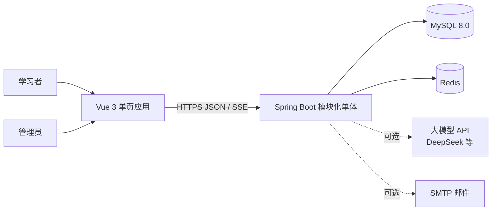
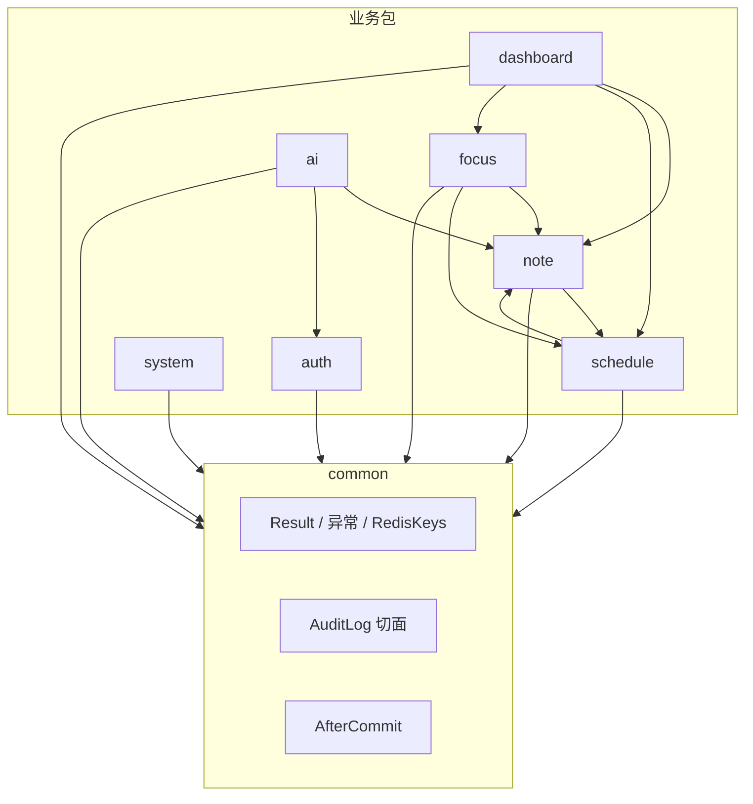
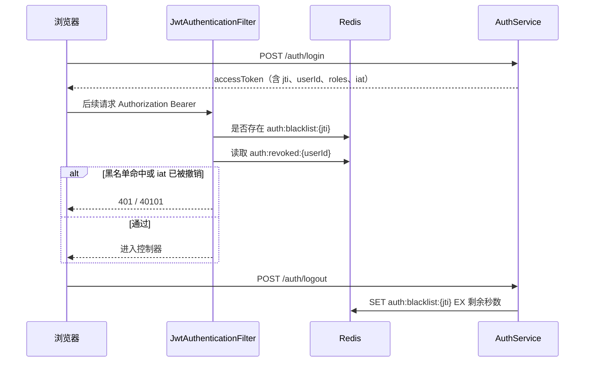
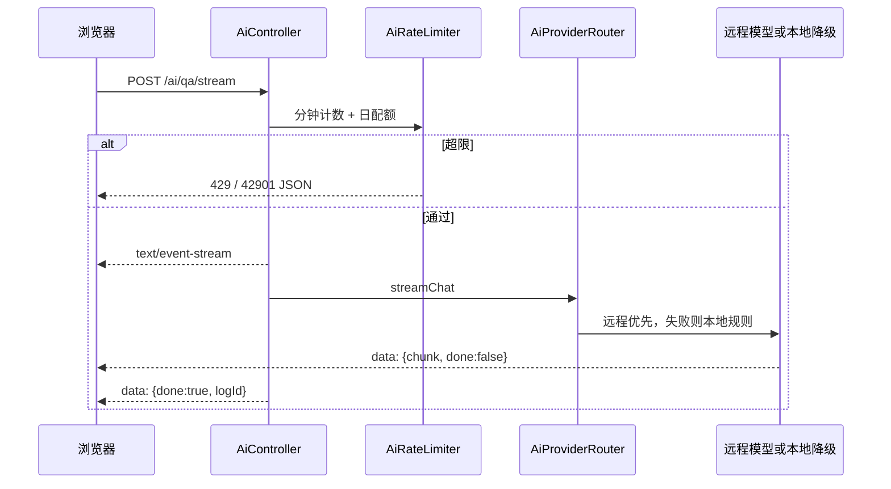
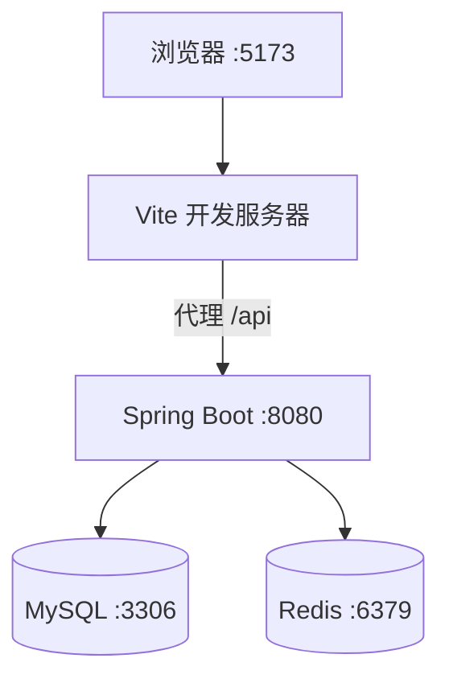

# 软件体系结构分析（循记 Xunji）

> 课程用途：软件体系结构分析作业的素材与论述底稿。图示采用 Mermaid，可直接粘贴到支持 Mermaid 的编辑器，或在答辩 PPT 中重绘为 C4 / 时序图。  
> 事实来源：`docs/requirements.md`、`docs/api-contract.md`、`docs/dev-log.md`、`backend/src/main/java/com/study/platform`。  
> 文档日期：2026-11-27。

## 1. 系统上下文与质量目标

综合学习辅助平台服务**单个学习者**和**系统管理员**。学习者完成「记笔记 → 排复习 → 专注执行 → 看统计」的闭环；管理员负责账号、AI 配额和审计。外部依赖只有三类：MySQL、Redis，以及可选的兼容 OpenAI 协议的大模型（默认 DeepSeek）和可选 SMTP。

质量目标按课程可展示性排序：

| 质量属性 | 本系统的具体目标 |
| :--- | :--- |
| 可修改性 | 换大模型厂商不改笔记、日程业务代码 |
| 安全性 | 无状态登录、登出即失效、用户数据按归属隔离、AI 防刷 |
| 性能 | 笔记详情和首页看板走缓存；笔记检索走全文索引 |
| 可用性 | 大模型或邮件不可用时，笔记、日程、番茄钟仍可使用 |
| 可测试性 | 领域规则可单测；接口契约固定，前后端可独立验收 |
| 可部署性 | 单进程后端 + 静态前端，本地 MySQL/Redis 或 Docker Compose 均可 |

明确不做微服务、多人协同、社区和全库向量检索。这些边界写在 `docs/requirements.md` 的 Out-of-Scope，避免结构被范围蔓延撑破。

## 2. 架构风格：前后端分离 + 分层模块化单体

### 2.1 为什么不是微服务

单人、3–4 周、一门课要同时展示 Web、数据库和体系结构。若拆成认证、笔记、日程、AI 多个进程，会引入服务发现、分布式事务和联调成本，而业务事务（删除笔记本、批量生成复习日程、更新笔记标签）都落在同一个 MySQL 里，并不需要跨服务一致性。

因此采用**一个 Spring Boot 进程**，按业务域分包，包之间只通过 Service 接口通信，禁止跨包注入 Mapper。这样：

- 部署单元仍是一个 JAR，本地和答辩机器都好启动；
- 包边界已经按将来可拆分的限界上下文划好（`auth`、`note`、`schedule`、`focus`、`ai`、`dashboard`、`system`）；
- 报告里可以诚实写出「当前是模块化单体，演进到微服务的代价是把这些包的 Service 变成远程接口」。

### 2.2 C4：系统上下文

### 2.3 C4：容器

| 容器 | 技术 | 职责 |
| :--- | :--- | :--- |
| Web 前端 | Vue 3 + Vite + Pinia + Element Plus | 页面、路由守卫、SSE 消费。开发时把 `/api` 代理到 `8080` |
| 应用后端 | Spring Boot 3.5，端口 `8080` | REST、鉴权、事务、缓存、定时任务、AI 适配 |
| 关系数据库 | MySQL 8.0，库名 `smart_study` | 事务、关联、全文检索 |
| 缓存 | Redis | 登录态失效、热点缓存、AI 计数 |
| 外部模型 | OpenAI 兼容 HTTP | 摘要、问答、日程解析。无 Key 时不调用 |

### 2.4 逻辑分层与包边界

每个业务包内部仍是 Controller → Service → Mapper。跨包只允许依赖对方的 **只读或窄写 Service**，例如：

- `schedule` 通过 `NoteLinkQueryService` 取笔记标题，不注入 `NoteMapper`；
- `note` 通过 `ScheduleLinkQueryService` 取关联复习日程；
- `ai` 通过 `NoteAiAccessService` 读笔记并回写摘要，通过 `UserAiQuotaQueryService` 读每日配额；
- `dashboard` 通过 `NoteDashboardQueryService`、`ScheduleDashboardQueryService`、`FocusStatsQueryService` 聚合统计；
- `system` 的 AI 用量统计直接查 `ai_chat_log` 聚合，不依赖 `ai` 包去改调用记录。

跨包箭头表示「依赖对方的 Service 接口」，不是依赖 Mapper。`note` 与 `schedule` 的互相引用只停留在只读查询接口上，避免循环注入 Mapper。

## 3. 关键运行时机制

### 3.1 登录、注销与强制下线

JWT 无状态。注销把 `jti` 写入 `auth:blacklist:{jti}`，TTL 等于令牌剩余寿命。管理员踢人或禁用账号时，把当前 Unix 秒写入 `auth:revoked:{userId}`（TTL 24 小时）。过滤器比对令牌 `iat`：签发时间不晚于撤销时间则拒绝，返回 `40101`。过滤器不在每个请求里查 MySQL。

### 3.2 笔记详情的 Cache-Aside

读 `GET /notes/{id}`：先读 `note:detail:{noteId}`（TTL 15 分钟）。未命中则查 MySQL 并回填。关联日程不放进这条缓存，每次现查，避免日程变更把笔记正文缓存打脏。

写路径（更新、删除、恢复、改摘要）在事务里改 MySQL，用 `AfterCommit` 等事务提交成功后再删缓存。这样并发读不会在事务回滚前拿到「库已改、缓存已删」的空窗，也不会在回滚后把旧值删掉。

Redis 读写失败时笔记详情回退 MySQL，请求不因此返回 500。看板键 `dashboard:overview:{userId}`（TTL 5 分钟）在笔记、日程、专注写入后同样于提交后删除。

### 3.3 AI：策略、限流、流式与降级

`AiProvider` 是策略接口，两个实现：

- `OpenAiCompatibleAiProvider`：HTTP 调用 `{baseUrl}/chat/completions`，兼容 DeepSeek / OpenAI；
- `LocalFallbackAiProvider`：无 Key、超时或远程失败且 `app.ai.fallback-enabled=true` 时，用本地规则生成摘要、问答和日程 JSON。

`AiProviderRouter` 负责选择。业务服务只依赖路由结果，不出现厂商 URL。

限流在进入模型之前完成，保证 429 是普通 JSON，而不是一条断掉的 SSE：

1. `ai:rate:min:{userId}`，默认每分钟 6 次；
2. `ai:quota:day:{userId}:{yyyyMMdd}` 对比 `sys_user.ai_daily_limit`。

`POST /ai/qa/stream` 在请求线程上先做登录、归属和限流校验，再返回 `SseEmitter`。Spring Security 放行 `DispatcherType.ASYNC`，避免异步派发被当成未登录。前端用 Fetch 读 `text/event-stream`，可随时 `AbortController` 停止。

### 3.4 横切：审计与提醒

`@AuditLog` + `AuditLogAspect` 记录登录、注销、笔记删除、艾宾浩斯批量生成、专注上报和管理员变更。写审计日志失败只记错误，不回滚业务。

`ScheduleReminderJob` 每分钟扫描 `remind_time <= now` 且未提醒的待办。`app.mail.enabled=true` 且用户有邮箱时发 SMTP；否则记一条站内日志并仍把 `reminded` 置 1。单封失败不影响同批其他日程。

## 4. 质量属性战术对照

| 战术 | 落点 |
| :--- | :--- |
| 策略 / 适配器 | `AiProvider`、`OpenAiCompatibleAiProvider`、`LocalFallbackAiProvider`、`AiProviderRouter` |
| 信息隐藏 | 各包 Mapper 不外泄；跨包只用 Service |
| 事务脚本 + 提交后动作 | `@Transactional` + `AfterCommit` 删缓存 |
| 缓存旁路 | 笔记详情 15 分钟、看板 5 分钟，写后删键 |
| 认证令牌 + 服务端撤销 | JWT + Redis 黑名单 / 撤销时间戳 |
| 权限检查 | URL 级 `hasRole('ADMIN')`，数据级比对 `user_id` |
| 限流 | Redis 计数器，超限 `42901` |
| 超时与降级 | HTTP 客户端超时；无 Key 或失败走本地规则，或在关闭降级时返回 `50301` |
| 观察 | AOP 审计日志：模块、耗时、成功失败 |
| 乐观锁 | `note.version`，冲突 `40901` |

## 5. 架构决策记录（ADR）汇总

| 编号 | 决策 | 放弃的方案 | 原因 |
| :--- | :--- | :--- | :--- |
| ADR-001 | 前后端分离 + 模块化单体 | 微服务 | 单人交付，事务都在一个库内 |
| ADR-002 | MySQL 主存，Redis 只存可丢失或可重建的状态 | 把笔记正文放 Redis | 一致性与课程概念都更清楚 |
| ADR-003 | AI 用统一 `AiProvider`，问答用 SSE | 各业务直接调 HTTP；同步等完整回答 | 可替换厂商，长回答不把页面卡死 |
| ADR-004 | P0/P1/P2 与 Out-of-Scope 冻结 | 协同编辑、社区、全库 RAG | 防止范围失控 |
| ADR-005 | Cache-Aside，且在事务提交后删缓存 | 先删缓存再写库，或只靠 TTL | 降低回滚和并发脏读 |
| ADR-006 | 无 Key 或远程失败时本地规则降级 | 没有 Key 就让 AI 页面不可用 | 答辩机器不一定有外网额度 |
| ADR-007 | 跨模块禁止注入 Mapper | 为了少写接口直接注入对方 Mapper | 包边界在报告里站得住，也避免循环依赖 |

## 6. 部署视图

本地答辩推荐：

1. 本机 MySQL 8.0 已导入 `sql/schema.sql`；
2. `scripts/start-local.ps1` 拉起 Redis、后端和前端；
3. 浏览器打开 `http://127.0.0.1:5173`。

已有 Docker 的环境可用 `docker/docker-compose.yml` 只起 MySQL 与 Redis，应用仍在本机跑。后端配置全部来自环境变量或根目录 `.env`，仓库不提交密钥。

生产形态可以把 `frontend/dist` 交给 Nginx，并把 `/api` 反代到同一个 Spring Boot。本课程不要求上云。

## 7. 演进与非目标

若以后用户量和 AI 调用量上去，优先演进顺序是：

1. 把 `ai` 包后的 HTTP 调用放到独立线程池或队列（接口保持 `AiProvider`）；
2. 看板统计改为定时汇总表，而不是每次缓存失效后扫 90 天；
3. 最后才考虑把 `ai` 或 `system` 拆成独立进程。

不在本期做的结构：服务网格、分布式事务、向量库 RAG、多副本会话粘滞。笔记历史版本已实现：保存时写入 `note_history`，每篇保留最近 10 条，恢复前会先留下当前正文。
