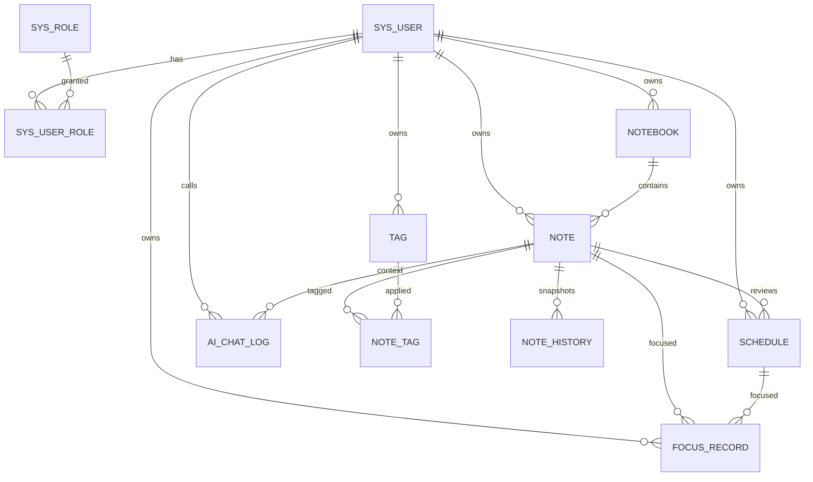

# 数据库设计与优化验证（循记 Xunji）

> 课程用途：数据库原理作业的 E-R、范式、索引与缓存一致性论述底稿。  
> 结构的唯一来源是 `sql/schema.sql`。优化实验脚本是 `sql/explain-lab.sql`，需要你在本地有数据后手动执行，本文不代替你机器上的 `EXPLAIN` 截图。  
> 文档日期：2026-11-27。

## 1. 存储分工

| 存储 | 类型 | 保存什么 | 不保存什么 |
| :--- | :--- | :--- | :--- |
| MySQL 8.0 `smart_study` | 关系型，InnoDB | 用户、权限、笔记、标签、日程、专注、AI 日志、审计日志 | JWT 原文、限流计数 |
| Redis | 键值，可过期 | 注销黑名单、踢人时间戳、笔记详情缓存、看板缓存、AI 计数 | 作为唯一副本的业务数据 |

Redis 中的笔记和看板都可以由 MySQL 重建。认证撤销键过期后，对应 JWT 也已过期，不要求持久一致。

字符集 `utf8mb4`，排序规则 `utf8mb4_0900_ai_ci`。笔记全文索引用 `ngram` 解析器，配合服务端 `ngram_token_size=2`。因此两个及以上汉字走 `MATCH ... AGAINST`，单字查询在应用层改为 `LIKE`，避免单字被全文索引丢掉。

## 2. 概念结构（E-R）



`NOTE_HISTORY` 已建表，应用尚未写入，属于 P2。`SYS_AUDIT_LOG` 只冗余 `user_id` 与用户名快照，不设外键，避免用户删除或匿名登录失败把审计记录级联掉。

## 3. 逻辑结构与范式

12 张表：11 张已使用，1 张预留。

| 表 | 主键 | 关系要点 | 范式处理 |
| :--- | :--- | :--- | :--- |
| `sys_user` | `id` | 账号、BCrypt 密码、邮箱、状态、AI 日配额 | 3NF |
| `sys_role` | `id` | `USER` / `ADMIN` | 3NF |
| `sys_user_role` | `(user_id, role_id)` | 用户与角色多对多 | 3NF |
| `notebook` | `id` | 用户下的单层笔记本 | 3NF |
| `note` | `id` | 正文、置顶、收藏、乐观锁 `version`、逻辑删除 | 见下文反范式 |
| `tag` | `id` | `(user_id, name)` 唯一 | 3NF |
| `note_tag` | `(note_id, tag_id)` | 笔记与标签多对多 | 3NF |
| `schedule` | `id` | 可空 `note_id`，优先级，来源，提醒标记 | 3NF |
| `focus_record` | `id` | 可空笔记、可空日程 | 3NF |
| `ai_chat_log` | `id` | 一次模型调用的提问、回答、耗时、成败 | 3NF |
| `sys_audit_log` | `id` | AOP 操作流水 | 用户名是快照 |
| `note_history` | `id` | 预留的正文快照 | 3NF，未启用 |

### 3.1 满足 3NF 的部分

- 角色不写进用户表，避免一个用户多个角色时的重复和更新异常。
- 标签不拼成笔记上的字符串，用 `note_tag` 关联，删除标签时由外键级联解开关联。
- 日程完成时间、提醒是否已发，都依赖日程自身，不从笔记表推导。

### 3.2 有意的反范式

| 字段 | 冗余了什么 | 原因 | 更新策略 |
| :--- | :--- | :--- | :--- |
| `note.ai_summary` | AI 摘要的最新一份 | 列表和详情不用再查 `ai_chat_log` | 只有摘要接口成功后回写，并删笔记缓存 |
| `note.word_count` | 可由正文计算 | 列表排序和展示不再扫 `MEDIUMTEXT` | 每次保存正文时重算 |
| `sys_audit_log.username` | 来自 `sys_user.username` | 审计要留下当时的操作者名字 | 只在写入日志时复制，不回写用户表 |

这些字段都不是别的实体的主属性被多处独立修改。摘要以 `ai_chat_log` 为调用历史，`note.ai_summary` 只是「当前展示值」。

### 3.3 完整性

- 用户删除时，其笔记本、笔记、标签、日程、专注、AI 日志级联删除。
- 笔记本删除时，笔记的 `notebook_id` 置空（`ON DELETE SET NULL`），笔记仍在。应用层删除笔记本还会先把该用户笔记的笔记本字段清空，并做逻辑删除。
- 笔记物理删除时，`schedule.note_id`、`focus_record.note_id`、`ai_chat_log.note_id` 置空，日程和专注记录保留。
- `note.version` 作乐观锁。更新条件带版本，影响行数为 0 时返回 `40901`。
- `deleted` 是逻辑删除。回收站查询必须显式写 `deleted = 1`，因为 MyBatis-Plus 全局配置会自动加上 `deleted = 0`。

## 4. 物理设计：索引与访问路径

| 索引 | 服务的访问 |
| :--- | :--- |
| `sys_user.uk_sys_user_username` | 登录按用户名查 |
| `notebook.idx_notebook_user_sort` | 某用户的笔记本按排序列出 |
| `note.idx_note_user_list` `(user_id, deleted, notebook_id, is_pinned, updated_at)` | 笔记列表：先限定用户和未删除，再按笔记本、置顶、时间 |
| `note.idx_note_user_fav` | 只看收藏 |
| `note.ft_note_title_content` ngram 全文 | 标题和正文关键词 |
| `tag.uk_tag_user_name` | 同一用户标签名不重复 |
| `schedule.idx_schedule_user_time` | 日历按用户和时间拉日程 |
| `schedule.idx_schedule_user_quadrant` | 四象限：用户 + 状态 + 优先级 |
| `schedule.idx_schedule_remind_scan` | 定时任务扫未提醒且到期的行 |
| `schedule.idx_schedule_note` | 某篇笔记的关联复习 |
| `focus_record.idx_focus_user_started` | 某人的专注历史、今日分钟数 |
| `ai_chat_log.idx_ai_log_user_time` | 个人 AI 历史 |
| `ai_chat_log.idx_ai_log_feature_time` | 管理端按功能统计 |
| `sys_audit_log.idx_audit_time` / `idx_audit_user_time` / `idx_audit_module` | 审计分页与筛选 |

列表的过滤列尽量落在联合索引的左前缀上：几乎所有业务查询都先等值匹配 `user_id`，避免扫到别人的行。

## 5. 事务边界

| 操作 | 事务里一起做的事 |
| :--- | :--- |
| 注册 | 插用户、绑定 `USER` 角色 |
| 删除笔记本 | 名下笔记 `notebook_id` 置空，再逻辑删除笔记本 |
| 更新笔记标签 | 校验归属、按版本更新正文、重写 `note_tag` |
| 彻底删除笔记 | 删 `note_tag`，再物理删除笔记 |
| 艾宾浩斯 | 校验笔记归属后插入 5 条日程 |
| 管理员改角色 | 清空再写入 `sys_user_role` |

缓存删除放在事务提交之后。业务提交失败时缓存保持原样。

## 6. 索引实验（本地执行）

脚本：`sql/explain-lab.sql`。它只给**当前管理员用户**追加一批标题以 `LAB` 开头的笔记，并给出三组 `EXPLAIN`。执行前确认 `smart_study` 已由 `sql/schema.sql` 建好，且存在启动时创建的 `admin`。

在 PowerShell 中（口令不要写进仓库，用交互输入）：

```powershell
& "C:\Program Files\MySQL\MySQL Server 8.0\bin\mysql.exe" --protocol=TCP -h 127.0.0.1 -P 3306 -u root -p --default-character-set=utf8mb4 smart_study -e "source D:/CursorWorkSpace/smart-study-platform/sql/explain-lab.sql"
```

建议截图对比：

1. **列表索引**：`EXPLAIN` 中 `key` 应为 `idx_note_user_list` 或至少使用 `user_id` 前缀，`type` 不应是全表 `ALL`。对照语句是去掉 `user_id` 条件的全表过滤（脚本里用 `EXPLAIN` 标出，不真的在无 `user_id` 条件下改数据）。
2. **全文索引**：两字及以上关键词的 `MATCH(title, content) AGAINST (... IN NATURAL LANGUAGE MODE)` 应出现 `ft_note_title_content`。
3. **单字**：`LIKE '%字%'` 通常无法用全文索引。这解释了应用对长度小于 2 的关键字改走 `LIKE`，而不是假装全文索引能覆盖单字。

脚本插入约 10000 行后，优化器才容易稳定选择二级索引。实验结束可执行脚本末尾的删除语句，只删 `title LIKE 'LAB:%'` 的行。

把 `EXPLAIN` 的 `type`、`key`、`rows`、`Extra` 贴进实验报告即可，本文不编造你机器上的行数。

## 7. 与 Redis 的一致性

采用 Cache-Aside：

1. 读：先 Redis，没有再 MySQL，再写入 Redis 并设置 TTL；
2. 写：先提交 MySQL，再删除对应键；
3. 下次读重新装入。

TTL 是兜底。笔记详情 15 分钟，看板 5 分钟。即使某次删除键失败，过期后也会回到数据库。Redis 故障时读路径直接查库。

AI 计数不是缓存，而是限流状态：分钟键 60 秒、日键约 25 小时。它们允许失败放开（fail open），避免 Redis 抖动把学习功能打成 500；日配额为 0 时在接触 Redis 之前就拒绝。

## 8. 安全相关的数据决定

- 密码只存 BCrypt，不存明文。
- 查询和更新都带当前 `user_id`。别人的主键返回 `40401` 或 `40301`，不靠前端隐藏。
- 全文检索的关键词长度限制为 100，避免超长布尔查询。
- 审计表记录 IP、路径和耗时，不记录密码和 API Key。
